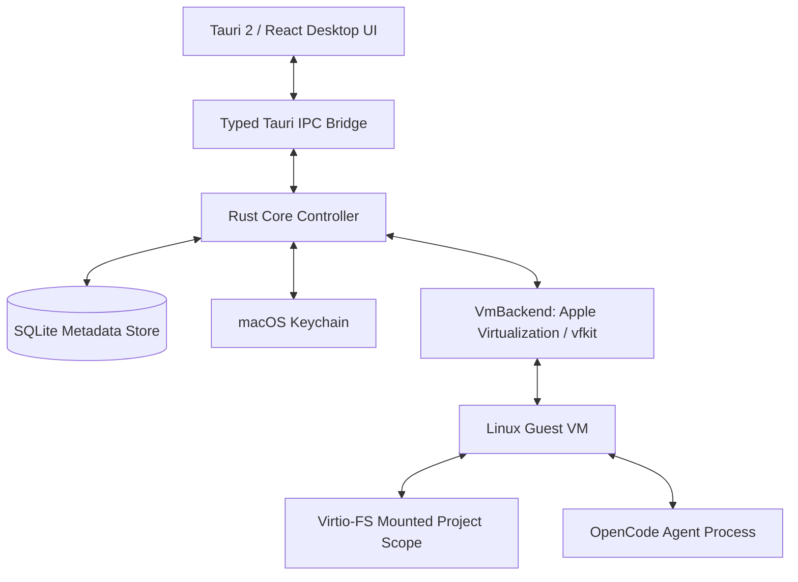

# macOS AI Agent Workbench - Architecture & Implementation Guide

## 1. System Overview

macOS AI Agent Workbench is a desktop application providing virtual machine isolation for AI coding agents (specifically **OpenCode**). Rather than running agent commands directly on the macOS host, the Workbench runs agent workflows inside dedicated Linux virtual machines using Apple's native **Virtualization Framework** via `vfkit`.

---

## 2. Security Boundaries & Path Isolation

### 2.1 Host Boundary Enforcement
- **`PathValidator` (`src/security/path_validator.rs`)**:
  - Rejects root (`/`), `/System`, `/Library`, `/usr`, `/private/etc`, and system `/var`.
  - Blocks direct mounting of the user home root (`~`).
  - Blocks access to sensitive host directories like `~/.ssh`, `~/.gnupg`, `~/.aws`, and Keychain stores.
  - Prevents directory traversal and symlink escapes with `ensure_within_root()`.

### 2.2 macOS Keychain Credential Storage
- Provider API keys (Anthropic, OpenAI, Gemini) are stored strictly in the macOS Keychain (`com.workbench.agent`).
- SQLite stores opaque metadata references (`cred-profile-<id>`), never raw secrets or bearer tokens.
- Application logs redact secrets automatically.

---

## 3. Virtualization Subsystem (`src/vm/`)

- **`VmBackend` Trait**: Decouples the workspace manager from specific hypervisors.
- **`VfkitBackend`**: Implements the trait using `vfkit` (Apple Virtualization framework):
  - `--cpus <n>`
  - `--memory <mb>`
  - `--restful-uri tcp://127.0.0.1:<port>`
  - `-d virtio-fs,sharedDir=<project_path>,mountTag=project`
  - `-d virtio-net,nat` (supporting `standard`, `restricted`, and `disabled` network modes)

---

## 4. OpenCode Agent Supervisor (`src/agent/`)

- Detects local OpenCode CLI version (`opencode --version`).
- Spawns and supervises agent sessions with bounded log retention.
- Tracks process IDs, exit codes, and cancellation triggers.

---

## 5. Persistence Layer (`src/persistence/`)

SQLite database stored at `~/.ai-agent-workbench/workbench.db`:
- `workspaces`: Workspace IDs, project paths, VM IDs, and resource configs.
- `agent_sessions`: OpenCode session histories, prompts, states, and exit statuses.
- `provider_profiles`: Profile labels, model choices, and Keychain references.
- `audit_events`: Full audit trail of VM boot, agent tasks, and workspace modifications.
