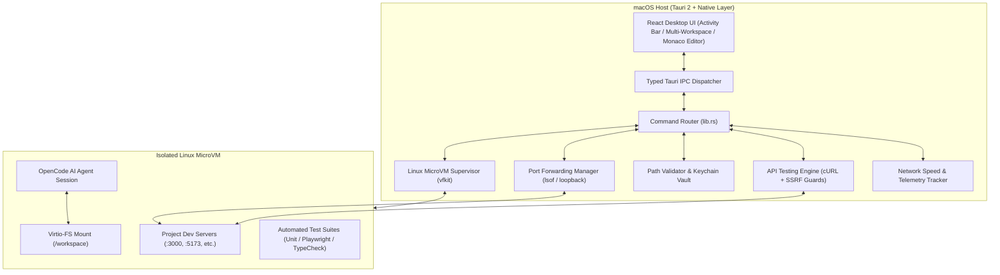

# macOS AI Agent Workbench - Architecture & System Design

## 1. System Overview

macOS AI Agent Workbench is a production-grade, AI-powered desktop developer environment that combines native macOS system capabilities with isolated virtual machine development. It provides an all-in-one developer workspace including an integrated web browser, API testing studio, automated testing engine, port forwarding manager, and secure AI agent control center.

---

## 2. Core Subsystems

### 2.1 Integrated Browser Workspace (`apps/desktop/src/features/browser/`)
- **Multi-Tab Webview Workspace**: Users can preview local web applications running inside the VM or host without switching away from the IDE.
- **Responsive Viewport Presets**: Instant switching between Desktop (100%), Laptop (1200px), Tablet (768px), and Mobile (375px) with device frames.
- **Sandboxed Execution**: Untrusted web applications execute inside a strict iframe sandbox (`sandbox="allow-scripts allow-same-origin allow-forms allow-popups"`), preventing untrusted frontend code from accessing privileged Tauri host APIs.
- **Inspection Drawer**: Live console output and network request logs captured directly from the preview instance.
- **AI Agent Integration**:
  - `Capture Screenshot`: Snapshots viewport state and passes visual context to the AI agent.
  - `Create Debug Task from Error`: 1-click generation of agent prompts containing console error messages and stack traces.

### 2.2 API Testing Studio (`apps/desktop/src/features/api/` & `src-tauri/src/commands/api_client.rs`)
- **HTTP Engine**: Supports `GET`, `POST`, `PUT`, `PATCH`, `DELETE`, `HEAD`, `OPTIONS`.
- **SSRF Protection**: Kernel-level blocking of cloud metadata IP addresses (`169.254.169.254` and `metadata.google.internal`) and rejection of non-HTTP schemes (e.g. `file://`, `ftp://`, `gopher://`).
- **Authentication**: Bearer tokens, HTTP Basic Auth, and API Keys (Header or Query param).
- **Environment Profiles**: Reusable environments (Local, Staging, Production) with variable replacement (e.g. `{{baseUrl}}`, `{{token}}`).
- **Postman & OpenAPI**: Import and export collections compliant with Postman v2.1 and OpenAPI 3.0.
- **Collection Suite Runner**: Sequentially executes collections with pass/fail reports and latency benchmarks.

### 2.3 Port Forwarding Manager (`apps/desktop/src/features/ports/` & `src-tauri/src/commands/ports.rs`)
- **Automated Service Discovery**: Uses native `lsof -iTCP -sTCP:LISTEN -n -P` to discover listening TCP/HTTP servers running on local ports.
- **Loopback-Only Enforcement**: Every forwarded port binds strictly to `127.0.0.1`. No WAN or LAN interfaces are exposed without explicit user authorization.
- **Conflict Detection**: Checks host port availability with `ports_check_availability` before starting tunnels.
- **Direct Browser Navigation**: "Browse" action immediately opens the target port in the Integrated Browser workspace.

### 2.4 Automatic Testing Engine (`apps/desktop/src/features/testing/`)
- **Multi-Category Test Runner**:
  - Unit Tests (`vitest`, `cargo test`, `pytest`)
  - Integration Tests
  - End-to-End Browser Tests (Playwright Chromium headless)
  - TypeCheck & Static Analysis (`tsc --noEmit`, `clippy`)
- **Live Output Streaming**: Real-time console log streaming with status indicators.
- **Structured Failure Diagnostics**: Pinpoints failure assertions, expected vs received values, and stack traces.
- **AI Fix Loop**: 1-click "Fix with AI Agent" passes exact test failures and file paths to the AI agent to apply patches and re-run verification.

### 2.5 Unified Diagnostics & Telemetry (`apps/desktop/src/features/diagnostics/`)
- **Aggregated Log Streams**: Merges logs across MicroVM supervisor, Tauri IPC, PTY terminal, API client, and browser console into a searchable, filterable interface.
- **Sanitized AI Diagnostics**: "Diagnose with AI" sanitizes sensitive tokens before passing diagnostic context to the AI agent.

### 2.6 Security & Credential Isolation (`src-tauri/src/security/` & `src-tauri/src/credentials/`)
- **macOS Keychain**: Sensitive provider API keys (Anthropic, OpenAI, Gemini) are stored in the macOS Keychain (`com.workbench.agent`).
- **Path Validation**: `PathValidator` ensures project operations remain strictly within authorized project roots, blocking escapes and system directory tampering.
