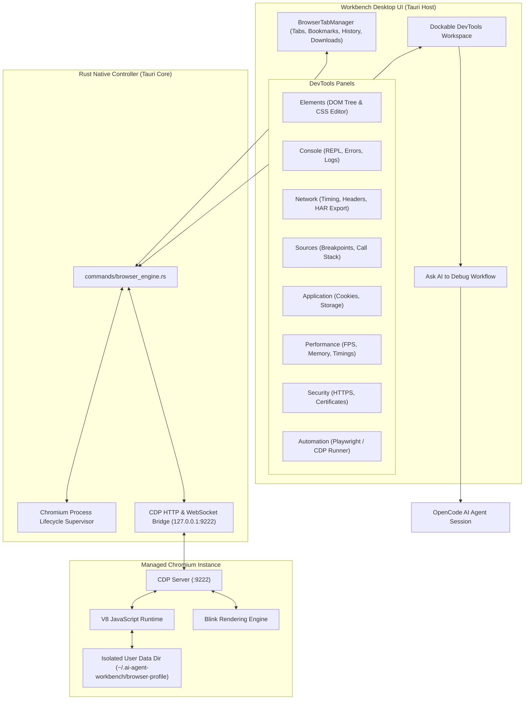

# System Browser & Developer Tools — Architecture & Design

## 1. Executive Evaluation & Engine Selection

To build a professional, full-system browser with developer capabilities comparable to Chrome DevTools inside the macOS AI Agent Workbench, three architectural approaches were evaluated:

### 1.1 Evaluated Architecture Options

| Architecture | Debugging & CDP Capabilities | macOS Native Support | Performance & Memory | Isolation & Security | Feasibility & Maintenance |
|---|---|---|---|---|---|
| **Option A: Tauri / Wry WebKit WebView** | Limited (No native CDP, restricted console/network events via JS injection) | Excellent (WKWebView native) | Lightweight (~30MB) | Uses WKWebView sandboxing, but lacks advanced DevTools APIs | Medium; cannot support full DOM/CSS live mutation, HAR export, or CDP breakpoints out-of-the-box |
| **Option B: Chromium Embedded Framework (CEF)** | Full DevTools | Complex C++ bindings on macOS, large binary footprint (+250MB) | Heavy | High | High maintenance, binary distribution complexity |
| **Option C: Separately Managed Chromium with CDP (Recommended)** | **Full Chrome DevTools Protocol (CDP 1.3 / v8)** | Native macOS application binary (`/Applications/Google Chrome.app`) | Optimized by host engine | **Strict process & loopback isolation; isolated profile directory** | **High; standard CDP protocol over loopback 127.0.0.1; zero extra binary bloat** |

### 1.2 Decision: Managed Chromium Engine with Dual Presentation & CDP Bridge

We implement **Option C with an integrated dual-mode presentation architecture**:
1. **Managed Chromium Engine Subsystem**:
   - Spawns Google Chrome/Chromium with `--remote-debugging-port=9222`, `--user-data-dir=~/.ai-agent-workbench/browser-profile`, `--no-first-run`, `--disable-sync`, `--no-default-browser-check`.
   - Provides full Chrome DevTools Protocol (CDP) connectivity over `ws://127.0.0.1:9222` and `http://127.0.0.1:9222/json`.
   - Supports live DOM inspection, CSS mutation, Console REPL evaluation, Network interception with HAR export, Performance metrics, Storage inspection, and automated testing.
2. **Integrated Workbench Browser Workspace**:
   - Embedded interactive viewport inside the IDE with multi-tab management, address bar, responsive viewport framing (Desktop, Laptop, Tablet, Mobile), zoom, bookmarks, history, and downloads.
   - Comprehensive Dockable DevTools panels: Elements, Console, Network, Sources, Application, Performance, Security, and Automation.
   - Isolated iframe sandbox (`sandbox="allow-scripts allow-same-origin allow-forms allow-popups"`) preventing arbitrary web content from executing privileged Tauri host commands.

---

## 2. Core Architectural Components

### 2.1 `BrowserTabManager`
- Manages active and background tabs (`BrowserTab`).
- Tracks URL, title, favicon, loading state, navigation history stack (back/forward), and security indicators.
- Handles tab duplication, pinning, reopening recently closed tabs, and bookmarks.

### 2.2 `CDPClient` (`src-tauri/src/commands/browser_engine.rs`)
- Connects to `http://127.0.0.1:9222/json` to query active targets and tabs.
- Creates new targets (`PUT /json/new?<url>`) and closes targets (`/json/close/<id>`).
- Dispatches CDP commands:
  - `Runtime.evaluate`: Evaluates arbitrary JavaScript within the page context and returns evaluated objects.
  - `Page.captureScreenshot`: Captures viewport or full-page PNG screenshots.
  - `Network.emulateNetworkConditions`: Implements throttling (Fast 3G, Slow 3G, Offline).
  - `Emulation.setDeviceMetricsOverride`: Implements device metrics (width, height, deviceScaleFactor, mobile emulation).

### 2.3 `DevToolsWorkspace`
- **Elements Panel**: Interactive tree view supporting node selection, attribute editing, live CSS style manipulation, and visual box model metrics.
- **Console Panel**: Filterable message stream (`error`, `warn`, `info`, `log`) with expandable stack traces, log preservation across navigation, and interactive JavaScript evaluation REPL.
- **Network Panel**: Detailed request waterfall with status badges, method filters, header inspector, formatted JSON response viewers, and HAR export with automatic credential redaction.
- **Sources Panel**: Script navigator, source code viewer with line numbers, breakpoint toggles, and step execution controls.
- **Application Panel**: Storage explorer for Cookies, `localStorage`, `sessionStorage`, and Service Workers.
- **Performance Panel**: Navigation timing breakdown, long tasks indicators, and memory usage gauges.
- **Security Panel**: HTTPS connection status, TLS details, and mixed-content warnings.

### 2.4 `BrowserAutomationService`
- Exposes Playwright/CDP-compatible automation actions:
  - `navigate(url)`
  - `click(selector)`
  - `fill(selector, text)`
  - `waitForSelector(selector)`
  - `captureScreenshot()`
- Executes structured test plans with pass/fail reports and failure screenshots.

### 2.5 Contextual AI Debugging (`Ask AI to Debug`)
- Automatically extracts relevant console errors, unhandled exceptions, and failed HTTP requests from DevTools.
- Sanitizes authorization headers, cookies, and tokens.
- Packages context with file mappings and passes it directly to the AI Agent Control Center to analyze and apply fixes.
