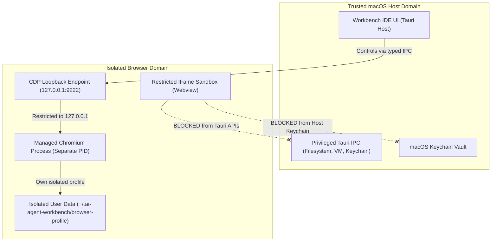

# System Browser & Developer Tools — Security & Isolation Model

## 1. Security Architecture & Threat Boundaries

Web browsing inherently involves executing untrusted HTML, CSS, and JavaScript from local development servers or external websites. The Workbench enforces strict boundaries to protect the macOS host and trusted IDE functions.

---

## 2. Core Security Controls

### 2.1 Complete Isolation from Tauri Host APIs
- Web content rendered inside the browser viewport is strictly sandboxed using:
  `sandbox="allow-scripts allow-same-origin allow-forms allow-popups"`
- The browser webview is completely isolated from the host `window.__TAURI__` and `window.__TAURI_INTERNALS__` namespaces.
- Untrusted scripts cannot invoke Tauri IPC commands, access host directories, read Keychain secrets, or execute shell commands.

### 2.2 Loopback-Only Binding for CDP
- The managed Chromium engine is configured with `--remote-debugging-port=9222` bound exclusively to `127.0.0.1`.
- The Port Forwarding Manager strictly excludes the internal CDP port (`9222`) from being forwarded or exposed to external LAN or WAN networks.
- All CDP interactions originate from the local trusted Rust process or local Workbench UI.

### 2.3 Separate Browser Profile Directory
- Chromium executes with an isolated user profile directory:
  `~/.ai-agent-workbench/browser-profile`
- The workbench browser does not share cookies, browsing history, extensions, or saved passwords with the user's personal Google Chrome, Safari, or Firefox profiles.
- Clearing browsing data only wipes the dedicated workbench profile without altering host system browser data.

### 2.4 Sensitive Credential Redaction in HAR Exports & AI Context
- When exporting network requests to HTTP Archive (`.har`) format or sending diagnostics to the AI Agent:
  - `Authorization: Bearer ...` and `Basic ...` headers are redacted to `Authorization: [REDACTED]`.
  - `Cookie` and `Set-Cookie` tokens are stripped.
  - Password fields in JSON request payloads are replaced with `"[REDACTED]"`.
  - API keys in query parameters (`?apiKey=...`, `?key=...`) are masked.

### 2.5 TLS & Certificate Validation
- Standard TLS certificate validation is enabled by default. Insecure or self-signed certificates trigger clear security warnings in the DevTools Security panel rather than silent bypasses.
