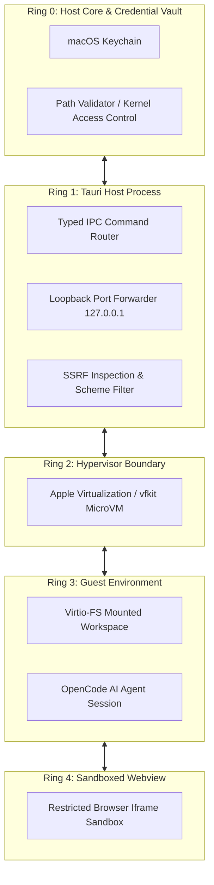

# macOS AI Agent Workbench - Security Model & Isolation Architecture

## 1. Threat Model & Design Principles

The macOS AI Agent Workbench operates under the core assumption that **agent-generated code, third-party project repositories, external API responses, and web application previews are untrusted inputs**.

The system implements a defense-in-depth model across five security rings:

---

## 2. Security Boundaries

### 2.1 Hypervisor & MicroVM Isolation
- **Linux MicroVM via Apple Virtualization Framework (`vfkit`)**:
  - The AI agent executes all compilation, runtime scripts, and terminal commands exclusively inside an isolated Linux microVM.
  - The agent has **no access to macOS host binaries, user applications, or host hardware devices**.
  - Host files are exposed solely through a dedicated `virtio-fs` mount scoped exclusively to the workspace directory (`/workspace`).

### 2.2 Filesystem Containment (`PathValidator`)
- Located at `src-tauri/src/security/path_validator.rs`:
  - **Forbidden Roots**: Completely rejects `/`, `/System`, `/Library`, `/usr`, `/bin`, `/sbin`, `/private`, `/etc`, and `/var`.
  - **Home Directory Root Protection**: Forbids mounting the user's entire `$HOME` directory directly.
  - **Sensitive Store Shielding**: Explicitly forbids mounting directories containing sensitive personal data or secrets, including `~/.ssh`, `~/.gnupg`, `~/.aws`, `~/.kube`, and macOS Keychain files.
  - **Symlink & Traversal Escape Defense**: Validates canonical paths using `ensure_within_root()`. Any attempt to escape via `..` or external symlinks is rejected before any filesystem call executes.

### 2.3 Untrusted Browser & Webview Sandbox
- Located at `apps/desktop/src/features/browser/IntegratedBrowser.tsx`:
  - Local frontend preview runs in an isolated `iframe` with `sandbox="allow-scripts allow-same-origin allow-forms allow-popups"`.
  - **Host API Protection**: The sandboxed iframe does **not** have access to `window.__TAURI__` or `window.__TAURI_INTERNALS__`. Malicious scripts inside web apps cannot invoke Tauri IPC commands or read host files.
  - Cross-origin navigation is monitored, and clear UI badges inform the user that the site is running in sandboxed execution.

### 2.4 API Testing Studio SSRF Defense
- Located at `src-tauri/src/commands/api_client.rs`:
  - **Protocol Filtering**: Rejects any non-HTTP/HTTPS protocol (e.g., `file://`, `ftp://`, `gopher://`, `dict://`).
  - **Cloud Metadata Blocking**: Strictly blocks requests directed at `169.254.169.254` (AWS/Azure/GCP metadata) and `metadata.google.internal` to prevent SSRF credential theft.
  - **Native cURL Execution**: Executes requests using native system TLS roots with explicit timeout limits (`--max-time`) and connect timeouts to prevent slowloris UI freezes.

### 2.5 Port Forwarding Loopback-Only Policy
- Located at `src-tauri/src/commands/ports.rs`:
  - Forwarded ports are **strictly bound to loopback (`127.0.0.1`)**.
  - No public interfaces (`0.0.0.0`) or LAN interfaces are opened without explicit user confirmation.
  - Host port collisions are checked prior to forwarding.

### 2.6 Credential & Keychain Security
- Located at `src-tauri/src/credentials/keychain.rs`:
  - Sensitive API tokens (Anthropic, OpenAI, Gemini) are stored in the **macOS Keychain** under service name `com.workbench.agent`.
  - SQLite database stores only opaque references (`cred-profile-<id>`), never plaintext tokens.
  - When prompts or logs are exported to AI agents or diagnostics, sensitive credentials are sanitized and redacted.
